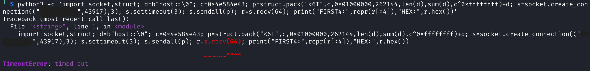

# ADB Verification

Send a single raw ADB greeting without installing ADB, generating authentication keys, pairing, or requesting a shell.

The original probe follows the official 24-byte ADB transport-header structure and sends only a CNXN introduction.

This probe does not pair, authenticate, request command execution, or intentionally change the device configuration.

## Run
```python
# python3 -c 'import socket,struct; d=b"host::\0"; c=0x4e584e43; p=struct.pack("<6I",c,0x01000000,262144,len(d),sum(d),c^0xffffffff)+d; s=socket.create_connection(("10.00.00.3",43917),3); s.settimeout(3); s.sendall(p); r=s.recv(64); print("FIRST4:",repr(r[:4]),"HEX:",r.hex())'
# target IP address redacted for publication
```

## Possible Results

| Response | Interpretation |
| --- | --- |
| `STLS` | Possible secure ADB transport response |
| `AUTH` | Possible ADB authentication response |
| `CNXN` | Possible ADB transport connection response |
| Empty response | The connection closed without returning data |
| TLS alert | TLS-related response rather than an ADB header |
| Timeout | No recognized response; ADB remains unconfirmed |

## Output



The device accepted TCP, received the ADB CNXN greeting, and gave us nothing back within three seconds.

Python returned `TimeoutError: timed out`.

Under the documented ADB transport protocol, an ADB endpoint may respond with STLS, AUTH, or CNXN. We received none.

## Current Conclusion

- Android/Linux-like OS fingerprint: supported, but not exact.
- TLS-aware service: supported.
- ADB service: unconfirmed.
- Application behind port 43917: still unknown.

**The application has NOT been identified yet.**

## Next

The next stage of the investigation examines discovery announcements visible through the physical Windows Wi-Fi adapter rather than WSL's virtual network interface.

## Clarification

A timeout does not definitively rule out ADB. A complete protocol response would require validation beyond its first four bytes.

## References

[AOSP ADB Transport Protocol](https://android.googlesource.com/platform/packages/modules/adb/+/refs/heads/android14-release/protocol.txt)

---

[Previous: IPv6 Fingerprint](IPV6FingerPrint.md) | [Return to README](README.md)
