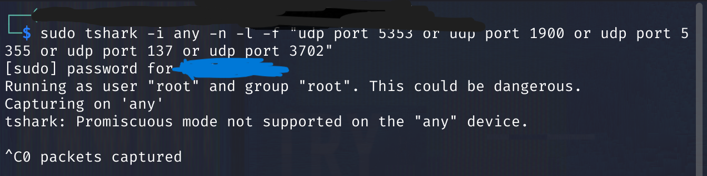
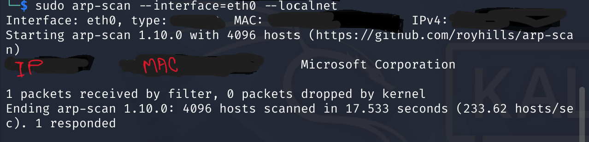
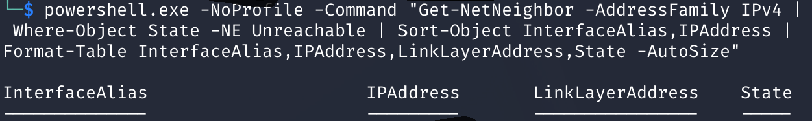

## 1. Device Discovery

Kali inside WSL with open terminal.

**Run:**

```bash
sudo tshark -i any -n -l -f "udp port 5353 or udp port 1900 or udp port 5355 or udp port 137 or udp port 3702"
```

Output indicates Kali is running inside WSL, therefore not directly attached to the physical LAN's broadcast segment.

**Output:**



---

To list interfaces TShark can see, **Run:**

```bash
sudo tshark -D
```

**Output:**


*eth0 is the network interface associated with WSL's virtual network.*

---

To make eth0 actively knock on every device's door that's visible at the Ethernet layer, **Run:**

```bash
sudo arp-scan --interface=eth0 --localnet
```

**Output:**


This just means you need to install the tool. Do this with:

```bash
sudo apt update && sudo apt install -y arp-scan
```

Once the prompt returns to `$`, re-run the previous command and allow it to finish.

**Output:**



This output confirms Kali is behind WSL2's synthetic NAT network, which means it never scanned the actual physical LAN.

NAT is WSL's default network architecture, and mirrored mode is available.

See [Microsoft's official documentation for WSL networking](https://learn.microsoft.com/windows/wsl/networking).

**Output findings:**

- Kali: [WSL IP REDACTED]
- Synthetic Windows gateway: [WSL GATEWAY REDACTED]
- `00:15:5d` is Microsoft's Hyper-V MAC range.
- 4,096 addresses tested.
- One synthetic Microsoft endpoint answered.

---

**Workaround:**

From this same Kali terminal, make Windows' real network adapter disclose every device currently present in its neighbor cache.

To extract devices Windows has communicated with, their private IP addresses, their MAC addresses, which physical or virtual adapter observed them and whether they are reachable, stale, probing, or permanent, run:

```bash
powershell.exe -NoProfile -Command "Get-NetNeighbor -AddressFamily IPv4 | Where-Object State -NE Unreachable | Sort-Object InterfaceAlias,IPAddress | Format-Table InterfaceAlias,IPAddress,LinkLayerAddress,State -AutoSize"
```

Ignore the virtual/broadcast garbage, identify the physical devices, and feed the interesting authorized targets back into Kali for actual service fingerprinting.

**Output:**



**Output findings:**

- `10.00.00.1` - Router/gateway.
- `10.00.00.2` - Previously observed device with a normal manufacturer-assigned MAC, currently Stale.
- `10.00.00.3` - Currently Reachable and using `00-00-00-00-00-00`, a redacted replacement for the original locally administered/randomized MAC. That hides the manufacturer. Common for phones and laptops.
- `224.*`, `239.*`, and `255.255.255.255` - Multicast/broadcast, not individual devices.
- [WSL SUBNET REDACTED] - WSL's synthetic network. NAT is WSL's default topology.

> **Redaction note:** IP and MAC addresses are illustrative placeholders, not actual network identifiers.

> **Clarification:** The Windows neighbor cache is not a complete inventory of every device on the network.
