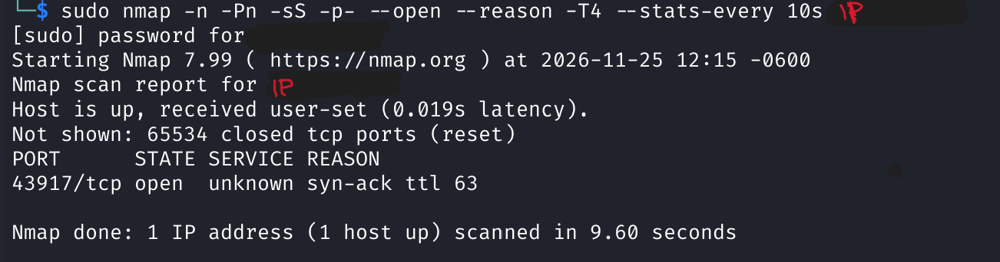

# Full TCP Discovery

This finds every open TCP port and records how the device responded. Maps exposure only.

Inside Kali terminal, for TCP discovery on the authorized test device, **Run:**

```bash
sudo nmap -n -Pn -sS -p- --open --reason -T4 --stats-every 10s <AUTHORIZED_TEST_IP>
```

Replace `<AUTHORIZED_TEST_IP>` with your own authorized test device's IP address.

Wait until terminal says: `Nmap done`

## Cmd Key

| Flag | Description |
| --- | --- |
| `-n` | Absolutely no DNS lookups. |
| `-Pn` | Scans even if the device ignores ping. |
| `-sS` | SYN scan rather than completing every connection. |
| `-p-` | Checks all 65,535 TCP ports, not Nmap's basic shortlist. |
| `--open` | Suppresses irrelevant closed-port noise. |
| `--reason` | Shows why Nmap classified each result. |
| `-T4` | Uses aggressive timing. |
| `--stats-every 10s` | Shows that the scan is still working. |

## Output



## Findings

- `10.00.00.3` is alive.
- It rejected 65,534 TCP ports with resets.
- Exactly one TCP port was observed open: `43917/tcp`.
- The port returned a SYN-ACK with TTL 63.
- Its MAC is randomized/local rather than manufacturer-identifying, based on the previous device discovery findings.

TTL 63 is consistent with the device originating responses with TTL 64 and crossing one routing boundary, which is consistent with Linux, Android, and other Unix-backed stacks.

**Clarification:** The initial TTL and number of routing boundaries are hypotheses, not confirmed by TTL 63 alone.

**Redaction note:** Identifying IP addresses and usernames have been redacted. The original port number and technical findings have been retained.

---

[Previous: Device Discovery](DeviceDiscovery.md) | [Return to README](README.md) | [Next: Target IP Investigation](TargetIP.md)
