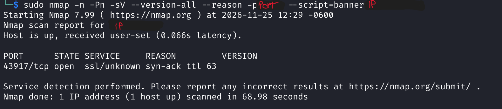
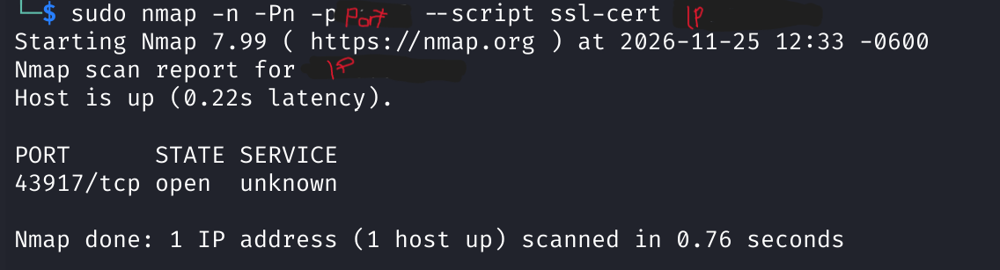
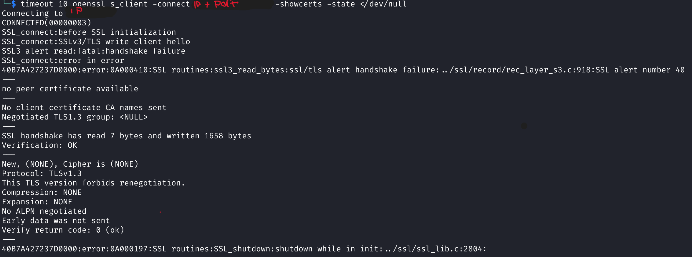
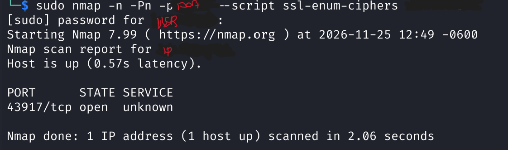

# The Unknown Device and TCP Service

10.00.00.3 is an active device using a randomized MAC and exposing one unidentified TCP service on port 43917.

ADB is known to produce this pattern, but to confirm the service identity, we would need additional protocol-specific evidence.

Right now, it is simply an unknown dynamic service.

## What we have observed

| Observation | What it supports | What it does not establish |
| --- | --- | --- |
| Randomized MAC [REDACTED] | A device using a locally administered address; common on phones, tablets, and laptops | Android, ADB, or even the device category |
| SYN-ACK TTL 63 | Possible initial TTL of 64 after one routed hop | Android specifically; Linux, macOS, iOS, and embedded systems commonly use 64 |
| Only TCP 43917 open | One service was observed listening on a high port | Which application or protocol owns it |
| ADB Wireless Debugging uses random TCP ports | ADB is technically compatible with this pattern | That this particular port is ADB |

---

## Protocol Identification Using Nmap

The next test examined the unknown service using Nmap's service-probe database.

**Output:**

**Findings:**

- Port 43917 is still open.
- Nmap classified the service as `ssl/unknown`.
- It did not return a plaintext banner.
- After approximately 69 seconds of probes, Nmap found no matching product signature.
- Nothing in this result identifies Android, ADB, malware, or any particular application.

---

## SSL Certificate Retrieval

The next test attempted to retrieve SSL certificate artifacts.

If a certificate is accessible, relevant information includes:

- Subject and issuer.
- Common Name and alternate names.
- Validity period.
- Self-signed versus externally issued.
- Public-key type and size.
- Certificate fingerprint.
- Any device or application identity embedded in it.

**Output:**

**Findings:**

- The script recovered no certificate.
- Port 43917 remains open.
- The earlier version scan tentatively recognized TLS-like behavior.
- No successful certificate retrieval was observed.
- The application remains unidentified.

---

## Examining the Handshake

The OpenSSL test examined the behavior of the service during a standard TLS connection attempt.

Keywords to watch for in output:

- `CONNECTED`
- `SSL_connect`
- `no peer certificate`
- `unexpected eof`
- `alert`
- `reset`
- `verify error`

**Output:**

**Findings:**

- TCP connection succeeded: `CONNECTED`.
- OpenSSL sent a TLS ClientHello.
- The device immediately returned TLS fatal alert 40: `handshake_failure`.
- The connection died before a ServerHello, certificate, cipher, or application protocol was negotiated.
- Only 7 bytes came back, the size of a minimal TLS alert record.

### Important

| Output | Interpretation |
| --- | --- |
| `no peer certificate available` | The server did not present a certificate. |
| `Cipher is (NONE)` | No cryptographic session was established. |
| `No ALPN negotiated` | No application protocol was selected through ALPN. |
| `Verification: OK` | There was no peer certificate to verify. |
| `Protocol: TLSv1.3` | Does not establish that a TLS 1.3 session succeeded. |

**The application has NOT been identified yet.**

---

## TLS and Cipher Suite Enumeration

The next test examined whether Nmap could identify supported TLS versions or cipher suites.

**Output:**

**Findings:**

- Port 43917 remains open.
- No cipher-enumeration results were returned.
- No additional application identity was established.

**Clarification:** Empty script output does not establish that every possible TLS configuration was attempted or rejected.

---

## Evidence-Backed Conclusions So Far

- TCP 43917 accepts connections.
- It recognizes a TLS ClientHello well enough to return fatal TLS alert 40.
- OpenSSL's generic handshake did not succeed.
- Nmap produced no cipher-enumeration results.
- The tests revealed no certificate, banner, negotiated cipher, or application identity.
- Nmap's earlier `ssl/unknown` label means TLS-like behavior was detected, not that a normal TLS session was successfully negotiated.

**Service identification remains unresolved.**

> **Redaction note:** Identifying IP addresses, usernames, and MAC addresses have been redacted. Original technical observations and screenshots have been retained.

---

[Previous: Full TCP Discovery](FullTCPDiscovery.md) | [Return to README](README.md)
