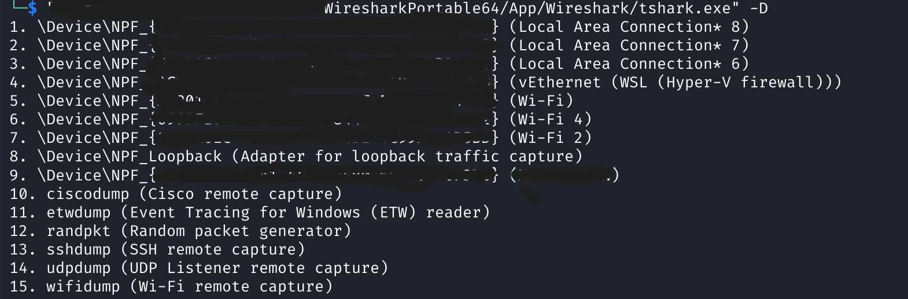

# WSL NAT Bypass

To bypass WSL's synthetic NAT network, I used the Windows/Npcap copy of TShark through the Kali terminal.

## Wireshark Portable Setup

Prior to this investigation, I had already downloaded and extracted the x64 version of Wireshark Portable on my Windows machine.

[Official Wireshark Download](https://www.wireshark.org/download.html)

Because I was using the portable version, my executable was located inside the WiresharkPortable64 directory rather than the standard Windows Program Files directory.

WSL allows Windows executables to be called directly from the Kali terminal.

To list the physical capture interfaces visible to Windows TShark, **Run:**

```bash
"/mnt/c/Users/<USERNAME>/Downloads/WiresharkPortable64/App/Wireshark/tshark.exe" -D
```

Replace `<USERNAME>` with your Windows username and adjust the path if necessary.

## Output

90-second packet capture
Redaction note: Original packet transcript with consistent synthetic IP addresses, MAC addresses and UDP ports. Relative timestamps, packet lengths, protocol labels and row order are retained. IP placeholders are display labels, not executable target addresses. The adapter name and terminal prompt are omitted.

Capturing on [Windows Wi-Fi adapter]
    1 0.000000000    10.00.00.4 → 10.00.00.3   UDP 80 55000 → 36000 Len=38
    2 0.861227700 0.861227700   10.00.00.3 → 10.00.00.4   UDP 80 36000 → 55000 Len=38
    3 1.883717000 1.022489300 169.254.100.2 → 239.255.255.250 SSDP 232 M-SEARCH * HTTP/1.1
    4 1.883718500 0.000001500 169.254.100.2 → 239.255.255.250 SSDP 236 M-SEARCH * HTTP/1.1
    5 1.883722300 0.000003800 169.254.100.2 → 239.255.255.250 SSDP 240 M-SEARCH * HTTP/1.1
    6 1.884223900 0.000501600 169.254.100.2 → 239.255.255.250 SSDP 233 M-SEARCH * HTTP/1.1
    7 2.004456600 0.120232700   10.00.00.4 → 10.00.00.3   UDP 80 55000 → 36000 Len=38
    8 2.038050500 0.033593900 02:11:22:33:44:55 → 02:aa:bb:cc:dd:ee ARP 42 Who has 10.00.00.4? Tell 10.00.00.3
    9 2.038092900 0.000042400 02:aa:bb:cc:dd:ee → 02:11:22:33:44:55 ARP 42 10.00.00.4 is at 02:aa:bb:cc:dd:ee
   10 4.007524900 1.969432000   10.00.00.4 → 10.00.00.3   UDP 1510 55000 → 36000 Len=1468
   11 6.012107900 2.004583000   10.00.00.4 → 10.00.00.3   UDP 80 55000 → 36000 Len=38
   12 6.386931400 0.374823500   10.00.00.3 → 10.00.00.4   IPv4 1514 Fragmented IP protocol (proto=UDP 17, off=0, ID=dfdb)
   13 6.388043700 0.001112300   10.00.00.3 → 10.00.00.4   UDP 50 36000 → 55000 Len=1488
   14 6.902096600 0.514052900 169.254.100.2 → 239.255.255.250 SSDP 232 M-SEARCH * HTTP/1.1
   15 6.902098300 0.000001700 169.254.100.2 → 239.255.255.250 SSDP 236 M-SEARCH * HTTP/1.1
   16 6.902100300 0.000002000 169.254.100.2 → 239.255.255.250 SSDP 240 M-SEARCH * HTTP/1.1
   17 6.902101300 0.000001000 169.254.100.2 → 239.255.255.250 SSDP 233 M-SEARCH * HTTP/1.1
   18 8.019865900 1.117764600   10.00.00.4 → 10.00.00.3   UDP 80 55000 → 36000 Len=38
   19 8.719576900 0.699711000 02:aa:bb:cc:dd:ee → 02:11:22:33:44:55 ARP 42 Who has 10.00.00.3? Tell 10.00.00.4
   20 8.752961100 0.033384200 02:11:22:33:44:55 → 02:aa:bb:cc:dd:ee ARP 60 10.00.00.3 is at 02:11:22:33:44:55
   21 10.035634400 1.282673300   10.00.00.4 → 10.00.00.3   UDP 80 55000 → 36000 Len=38
   22 12.044642000 2.009007600   10.00.00.4 → 10.00.00.3   UDP 80 55000 → 36000 Len=38
   23 14.061062700 2.016420700   10.00.00.4 → 10.00.00.3   UDP 80 55000 → 36000 Len=38
   24 14.219190500 0.158127800 02:aa:bb:cc:dd:ee → 02:00:00:00:00:01 ARP 42 Who has 10.00.00.1? Tell 10.00.00.4
   25 14.236030200 0.016839700 02:00:00:00:00:01 → 02:aa:bb:cc:dd:ee ARP 42 10.00.00.1 is at 02:00:00:00:00:01
   26 16.068592400 1.832562200   10.00.00.4 → 10.00.00.3   UDP 80 55000 → 36000 Len=38
   27 16.319412800 0.250820400   10.00.00.3 → 10.00.00.4   UDP 80 36000 → 55000 Len=38
   28 18.079437600 1.760024800   10.00.00.4 → 10.00.00.3   UDP 80 55000 → 36000 Len=38
   29 18.882606200 0.803168600 169.254.100.2 → 239.255.255.250 SSDP 232 M-SEARCH * HTTP/1.1
   30 18.882607700 0.000001500 169.254.100.2 → 239.255.255.250 SSDP 236 M-SEARCH * HTTP/1.1
   31 18.883131800 0.000524100 169.254.100.2 → 239.255.255.250 SSDP 240 M-SEARCH * HTTP/1.1
   32 18.883133100 0.000001300 169.254.100.2 → 239.255.255.250 SSDP 233 M-SEARCH * HTTP/1.1
   33 20.075875400 1.192742300   10.00.00.4 → 10.00.00.3   UDP 80 55000 → 36000 Len=38
   34 22.086210700 2.010335300   10.00.00.4 → 10.00.00.3   UDP 80 55000 → 36000 Len=38
   35 23.901220900 1.815010200 169.254.100.2 → 239.255.255.250 SSDP 232 M-SEARCH * HTTP/1.1
   36 23.901222600 0.000001700 169.254.100.2 → 239.255.255.250 SSDP 236 M-SEARCH * HTTP/1.1
   37 23.901225800 0.000003200 169.254.100.2 → 239.255.255.250 SSDP 240 M-SEARCH * HTTP/1.1
   38 23.901226700 0.000000900 169.254.100.2 → 239.255.255.250 SSDP 233 M-SEARCH * HTTP/1.1
   39 24.100834300 0.199607600   10.00.00.4 → 10.00.00.3   UDP 1510 55000 → 36000 Len=1468
   40 26.109067200 2.008232900   10.00.00.4 → 10.00.00.3   UDP 80 55000 → 36000 Len=38
   41 26.792254000 0.683186800   10.00.00.3 → 10.00.00.4   UDP 80 36000 → 55000 Len=38
   42 28.124231900 1.331977900   10.00.00.4 → 10.00.00.3   UDP 80 55000 → 36000 Len=38
   43 28.918991100 0.794759200 169.254.100.2 → 239.255.255.250 SSDP 232 M-SEARCH * HTTP/1.1
   44 28.918992600 0.000001500 169.254.100.2 → 239.255.255.250 SSDP 236 M-SEARCH * HTTP/1.1
   45 28.918994600 0.000002000 169.254.100.2 → 239.255.255.250 SSDP 240 M-SEARCH * HTTP/1.1
   46 28.918995400 0.000000800 169.254.100.2 → 239.255.255.250 SSDP 233 M-SEARCH * HTTP/1.1
   47 30.127551300 1.208555900   10.00.00.4 → 10.00.00.3   UDP 80 55000 → 36000 Len=38
   48 30.966831000 0.839279700 02:00:00:00:00:01 → 02:aa:bb:cc:dd:ee ARP 42 Who has 10.00.00.4? Tell 10.00.00.1
   49 30.966877600 0.000046600 02:aa:bb:cc:dd:ee → 02:00:00:00:00:01 ARP 42 10.00.00.4 is at 02:aa:bb:cc:dd:ee
   50 32.130143300 1.163265700   10.00.00.4 → 10.00.00.3   UDP 80 55000 → 36000 Len=38
   51 34.135482800 2.005339500   10.00.00.4 → 10.00.00.3   UDP 80 55000 → 36000 Len=38
   52 34.714748500 0.579265700 02:aa:bb:cc:dd:ee → 02:11:22:33:44:55 ARP 42 Who has 10.00.00.3? Tell 10.00.00.4
   53 34.759990000 0.045241500 02:11:22:33:44:55 → 02:aa:bb:cc:dd:ee ARP 60 10.00.00.3 is at 02:11:22:33:44:55
   54 36.143464500 1.383474500   10.00.00.4 → 10.00.00.3   UDP 80 55000 → 36000 Len=38
   55 38.139412600 1.995948100   10.00.00.3 → 10.00.00.4   UDP 80 36000 → 55000 Len=38
   56 38.145743100 0.006330500   10.00.00.4 → 10.00.00.3   UDP 80 55000 → 36000 Len=38
   57 40.157376500 2.011633400   10.00.00.4 → 10.00.00.3   UDP 80 55000 → 36000 Len=38
   58 40.899595500 0.742219000 169.254.100.2 → 239.255.255.250 SSDP 232 M-SEARCH * HTTP/1.1
   59 40.899597000 0.000001500 169.254.100.2 → 239.255.255.250 SSDP 236 M-SEARCH * HTTP/1.1
   60 40.899598800 0.000001800 169.254.100.2 → 239.255.255.250 SSDP 240 M-SEARCH * HTTP/1.1
   61 40.899599900 0.000001100 169.254.100.2 → 239.255.255.250 SSDP 233 M-SEARCH * HTTP/1.1
   62 42.161718100 1.262118200   10.00.00.4 → 10.00.00.3   UDP 80 55000 → 36000 Len=38
   63 44.170157100 2.008439000   10.00.00.4 → 10.00.00.3   UDP 1510 55000 → 36000 Len=1468
   64 45.291182700 1.121025600   10.00.00.4 → 10.00.00.3   UDP 600 55000 → 36000 Len=558
   65 45.537572500 0.246389800   10.00.00.4 → 10.00.00.3   UDP 602 55000 → 36000 Len=560
   66 45.815762600 0.278190100   10.00.00.3 → 10.00.00.4   UDP 322 36000 → 55000 Len=280
   67 45.815765600 0.000003000   10.00.00.3 → 10.00.00.4   UDP 651 36000 → 55000 Len=609
   68 45.818224400 0.002458800   10.00.00.4 → 10.00.00.3   UDP 413 55000 → 36000 Len=371
   69 45.831901700 0.013677300   10.00.00.4 → 10.00.00.3   UDP 1409 55000 → 36000 Len=1367
   70 45.833570100 0.001668400   10.00.00.4 → 10.00.00.3   UDP 297 55000 → 36000 Len=255
   71 45.845804100 0.012234000   10.00.00.3 → 10.00.00.4   UDP 404 36000 → 55000 Len=362
   72 45.870003700 0.024199600   10.00.00.4 → 10.00.00.3   UDP 85 55000 → 36000 Len=43
   73 45.916722000 0.046718300 169.254.100.2 → 239.255.255.250 SSDP 232 M-SEARCH * HTTP/1.1
   74 45.916722900 0.000000900 169.254.100.2 → 239.255.255.250 SSDP 236 M-SEARCH * HTTP/1.1
   75 45.916723600 0.000000700 169.254.100.2 → 239.255.255.250 SSDP 240 M-SEARCH * HTTP/1.1
   76 45.917586400 0.000862800 169.254.100.2 → 239.255.255.250 SSDP 233 M-SEARCH * HTTP/1.1
   77 48.189697700 2.272111300   10.00.00.4 → 10.00.00.3   UDP 80 55000 → 36000 Len=38
   78 50.203471300 2.013773600   10.00.00.4 → 10.00.00.3   UDP 80 55000 → 36000 Len=38
   79 50.935676100 0.732204800 169.254.100.2 → 239.255.255.250 SSDP 232 M-SEARCH * HTTP/1.1
   80 50.935677400 0.000001300 169.254.100.2 → 239.255.255.250 SSDP 236 M-SEARCH * HTTP/1.1
   81 50.935679000 0.000001600 169.254.100.2 → 239.255.255.250 SSDP 240 M-SEARCH * HTTP/1.1
   82 50.935679700 0.000000700 169.254.100.2 → 239.255.255.250 SSDP 233 M-SEARCH * HTTP/1.1
   83 52.220303100 1.284623400 02:aa:bb:cc:dd:ee → 02:00:00:00:00:01 ARP 42 Who has 10.00.00.1? Tell 10.00.00.4
   84 52.220664600 0.000361500   10.00.00.4 → 10.00.00.3   UDP 80 55000 → 36000 Len=38
   85 52.232658300 0.011993700 02:00:00:00:00:01 → 02:aa:bb:cc:dd:ee ARP 42 10.00.00.1 is at 02:00:00:00:00:01
   86 54.231097500 1.998439200   10.00.00.4 → 10.00.00.3   UDP 80 55000 → 36000 Len=38
   87 56.239099700 2.008002200   10.00.00.4 → 10.00.00.3   UDP 80 55000 → 36000 Len=38
   88 58.246189200 2.007089500   10.00.00.4 → 10.00.00.3   UDP 80 55000 → 36000 Len=38
   89 58.616258100 0.370068900   10.00.00.3 → 10.00.00.4   UDP 80 36000 → 55000 Len=38
   90 59.213185700 0.596927600 02:aa:bb:cc:dd:ee → 02:11:22:33:44:55 ARP 42 Who has 10.00.00.3? Tell 10.00.00.4
   91 59.640313800 0.427128100 02:11:22:33:44:55 → 02:aa:bb:cc:dd:ee ARP 60 10.00.00.3 is at 02:11:22:33:44:55
   92 60.262757900 0.622444100   10.00.00.4 → 10.00.00.3   UDP 80 55000 → 36000 Len=38
   93 62.278988800 2.016230900   10.00.00.4 → 10.00.00.3   UDP 80 55000 → 36000 Len=38
   94 62.447277800 0.168289000   10.00.00.3 → 10.00.00.4   UDP 80 36000 → 55000 Len=38
   95 62.916294100 0.469016300 169.254.100.2 → 239.255.255.250 SSDP 232 M-SEARCH * HTTP/1.1
   96 62.916295800 0.000001700 169.254.100.2 → 239.255.255.250 SSDP 236 M-SEARCH * HTTP/1.1
   97 62.916297400 0.000001600 169.254.100.2 → 239.255.255.250 SSDP 240 M-SEARCH * HTTP/1.1
   98 62.916298200 0.000000800 169.254.100.2 → 239.255.255.250 SSDP 233 M-SEARCH * HTTP/1.1
   99 64.284555700 1.368257500   10.00.00.4 → 10.00.00.3   UDP 1510 55000 → 36000 Len=1468
  100 64.456115800 0.171560100   10.00.00.3 → 10.00.00.4   UDP 80 36000 → 55000 Len=38
  101 66.286369000 1.830253200   10.00.00.4 → 10.00.00.3   UDP 80 55000 → 36000 Len=38
  102 66.449718000 0.163349000   10.00.00.3 → 10.00.00.4   UDP 80 36000 → 55000 Len=38
  103 67.933942400 1.484224400 169.254.100.2 → 239.255.255.250 SSDP 232 M-SEARCH * HTTP/1.1
  104 67.933943900 0.000001500 169.254.100.2 → 239.255.255.250 SSDP 236 M-SEARCH * HTTP/1.1
  105 67.933947000 0.000003100 169.254.100.2 → 239.255.255.250 SSDP 240 M-SEARCH * HTTP/1.1
  106 67.933947900 0.000000900 169.254.100.2 → 239.255.255.250 SSDP 233 M-SEARCH * HTTP/1.1
  107 68.287730400 0.353782500   10.00.00.4 → 10.00.00.3   UDP 80 55000 → 36000 Len=38
  108 70.287491300 1.999760900   10.00.00.4 → 10.00.00.3   UDP 80 55000 → 36000 Len=38
  109 71.825180900 1.537689600   10.00.00.3 → 10.00.00.4   UDP 80 36000 → 55000 Len=38
  110 72.295437000 0.470256100   10.00.00.4 → 10.00.00.3   UDP 80 55000 → 36000 Len=38
  111 72.951557900 0.656120900 169.254.100.2 → 239.255.255.250 SSDP 232 M-SEARCH * HTTP/1.1
  112 72.951559400 0.000001500 169.254.100.2 → 239.255.255.250 SSDP 236 M-SEARCH * HTTP/1.1
  113 72.951560900 0.000001500 169.254.100.2 → 239.255.255.250 SSDP 240 M-SEARCH * HTTP/1.1
  114 72.951561600 0.000000700 169.254.100.2 → 239.255.255.250 SSDP 233 M-SEARCH * HTTP/1.1
  115 74.310886100 1.359324500   10.00.00.4 → 10.00.00.3   UDP 80 55000 → 36000 Len=38
  116 76.318676400 2.007790300   10.00.00.4 → 10.00.00.3   UDP 80 55000 → 36000 Len=38
  117 78.327786400 2.009110000   10.00.00.4 → 10.00.00.3   UDP 80 55000 → 36000 Len=38
  118 79.195804100 0.868017700   10.00.00.4 → 10.00.00.3   UDP 600 55000 → 36000 Len=558
  119 79.506420900 0.310616800   10.00.00.3 → 10.00.00.4   UDP 324 36000 → 55000 Len=282
  120 79.506423200 0.000002300   10.00.00.3 → 10.00.00.4   UDP 651 36000 → 55000 Len=609
  121 79.508537600 0.002114400   10.00.00.4 → 10.00.00.3   UDP 413 55000 → 36000 Len=371
  122 79.509626900 0.001089300   10.00.00.4 → 10.00.00.3   UDP 879 55000 → 36000 Len=837
  123 79.517346500 0.007719600   10.00.00.3 → 10.00.00.4   UDP 402 36000 → 55000 Len=360
  124 79.547773800 0.030427300   10.00.00.4 → 10.00.00.3   UDP 82 55000 → 36000 Len=40
  125 82.343877900 2.796104100   10.00.00.4 → 10.00.00.3   UDP 80 55000 → 36000 Len=38
  126 82.563887600 0.220009700   10.00.00.3 → 10.00.00.4   IPv4 1514 Fragmented IP protocol (proto=UDP 17, off=0, ID=ebdf)
  127 82.563890300 0.000002700   10.00.00.3 → 10.00.00.4   UDP 50 36000 → 55000 Len=1488
  128 83.719155500 1.155265200 02:aa:bb:cc:dd:ee → 02:11:22:33:44:55 ARP 42 Who has 10.00.00.3? Tell 10.00.00.4
  129 84.115036800 0.395881300 02:11:22:33:44:55 → 02:aa:bb:cc:dd:ee ARP 60 10.00.00.3 is at 02:11:22:33:44:55
  130 84.351189800 0.236153000   10.00.00.4 → 10.00.00.3   UDP 1510 55000 → 36000 Len=1468
  131 84.980387100 0.629197300 169.254.100.2 → 239.255.255.250 SSDP 232 M-SEARCH * HTTP/1.1
  132 84.980388400 0.000001300 169.254.100.2 → 239.255.255.250 SSDP 236 M-SEARCH * HTTP/1.1
  133 84.980389800 0.000001400 169.254.100.2 → 239.255.255.250 SSDP 240 M-SEARCH * HTTP/1.1
  134 84.980390400 0.000000600 169.254.100.2 → 239.255.255.250 SSDP 233 M-SEARCH * HTTP/1.1
  135 86.358780100 1.378389700   10.00.00.4 → 10.00.00.3   UDP 80 55000 → 36000 Len=38
  136 86.718984800 0.360204700 02:aa:bb:cc:dd:ee → 02:00:00:00:00:01 ARP 42 Who has 10.00.00.1? Tell 10.00.00.4
  137 86.735999300 0.017014500 02:00:00:00:00:01 → 02:aa:bb:cc:dd:ee ARP 42 10.00.00.1 is at 02:00:00:00:00:01
  138 86.784954100 0.048954800 02:11:22:33:44:55 → 02:aa:bb:cc:dd:ee ARP 42 Who has 10.00.00.4? Tell 10.00.00.3
  139 86.785000100 0.000046000 02:aa:bb:cc:dd:ee → 02:11:22:33:44:55 ARP 42 10.00.00.4 is at 02:aa:bb:cc:dd:ee
  140 87.213021100 0.428021000 02:00:00:00:00:01 → 02:aa:bb:cc:dd:ee ARP 42 Who has 10.00.00.4? Tell 10.00.00.1
  141 87.213078800 0.000057700 02:aa:bb:cc:dd:ee → 02:00:00:00:00:01 ARP 42 10.00.00.4 is at 02:aa:bb:cc:dd:ee
  142 88.366640700 1.153561900   10.00.00.4 → 10.00.00.3   UDP 80 55000 → 36000 Len=38
  143 89.950440300 1.583799600 169.254.100.2 → 239.255.255.250 SSDP 232 M-SEARCH * HTTP/1.1
143 packets captured



## Findings

- Interface 5 is the physical Wi-Fi adapter.
- Interface 4 is WSL's synthetic adapter.
- Interfaces 6 and 7 are additional Wi-Fi/virtual interfaces.
- Interface 9 is a VPN interface.

Windows TShark can access capture interfaces that Kali's native TShark cannot directly access in the original WSL NAT configuration.

**Clarification:** Wireshark Portable still requires Npcap for live Windows packet capture. This method uses the Windows capture interface without disabling WSL NAT or network security protections.

**Redaction note:** Personal file paths and network adapter identifiers have been redacted.
