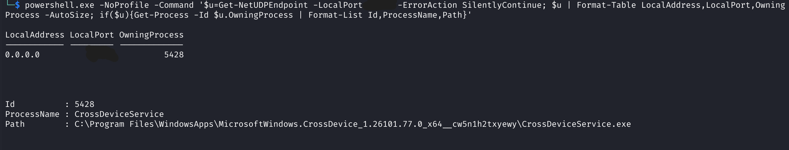

# Windows PID — Owner of UDP Port

To identify the Windows process that owns local UDP port 55000, **Run:**

```bash
powershell.exe -NoProfile -Command '$u=Get-NetUDPEndpoint -LocalPort 55000 -ErrorAction SilentlyContinue; $u | Format-Table LocalAddress,LocalPort,OwningProcess -AutoSize; if($u){Get-Process -Id $u.OwningProcess | Format-List Id,ProcessName,Path}'
```

This does not terminate or alter anything. It maps the captured port to:

- The owning Windows process ID.
- The process name.
- The executable path.

## Output



## Findings

Output identifies the Windows-side UDP endpoint as belonging to:

| Property | Value |
| --- | --- |
| Local address | 0.0.0.0 |
| Local UDP port | 55000 |
| Process ID | 5428 |
| Process name | CrossDeviceService |
| Executable | CrossDeviceService.exe |
| Package | MicrosoftWindows.CrossDevice |
| Version | 1.26101.77.0 |

Correlating this process with the previous packet capture provides evidence of communication between:

**Windows PC:** `10.00.00.4:55000`

**Target device:** `10.00.00.3:36000`

## CrossDeviceService Metadata

The original investigation also examined locally stored CrossDeviceService metadata.

The metadata contained linked-device records, operating system information, client types, capabilities, registration information and certificate data.

The original JSON output is withheld because it contains sensitive device identifiers and certificate material.

### Sanitized Metadata Findings

| Property | Value |
| --- | --- |
| Display name | [PHONE] |
| Manufacturer | Samsung |
| Model | [REDACTED] |
| OS | Android |
| Client type | LTW |
| Enabled | True |
| Cross-device capabilities | Present |

## Evidentiary Distinctions

| Evidence source | What it supports |
| --- | --- |
| Packet capture | Bidirectional UDP communication between the Windows PC and target device |
| Windows process identification | CrossDeviceService owns the observed local UDP endpoint |
| Local metadata | CrossDeviceService has a linked Android device registered |
| Nmap fingerprint | The target resembles a Linux/Android TCP/IP stack |
| Randomized MAC | The target uses a locally administered network address |

**What the JSON did not contain:** A direct mapping between `10.00.00.3` and the linked Android device.

Device identity requires additional corroborating evidence.

## Redaction Note

IP addresses, UDP ports and personal device identifiers have been replaced with synthetic values consistent with the previous investigation sections.

Original certificate blobs, persistent identifiers and private metadata have been withheld from the public edition.

---

[Previous: WSL NAT Bypass](WSLNATBypass.md) | [Return to README](README.md)
